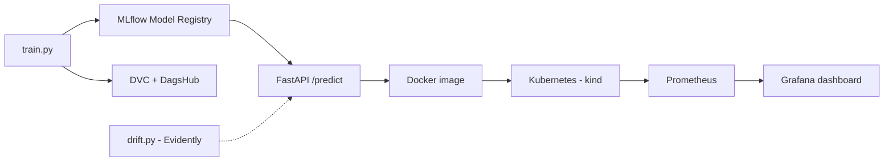
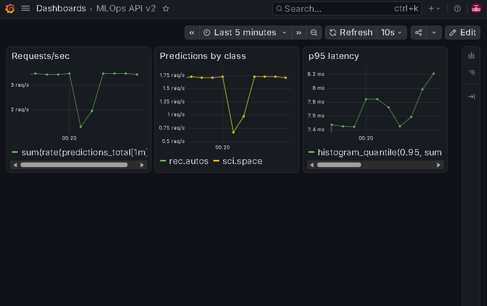

# MLOps Lab

End-to-end MLOps pipeline for a text classifier (20 Newsgroups: sci.space, rec.autos, talk.politics.misc).

## Stack

- **Model**: scikit-learn (TF-IDF + Logistic Regression), accuracy ~0.86
- **Serving**: FastAPI (`/health`, `/predict`, `/metrics`)
- **Experiment tracking & model registry**: MLflow (DagsHub), `production` alias
- **Data/model versioning**: DVC
- **Containerization**: Docker
- **CI**: GitHub Actions (ruff + pytest)
- **Deployment**: Kubernetes (kind), 2 replicas with readiness/liveness probes
- **Monitoring**: Prometheus + Grafana (kube-prometheus-stack via Helm), custom metrics `predictions_total` and `predict_latency_seconds`
- **Drift detection**: Evidently (`src/drift.py`), reference vs production data

## Run locally

    python -m venv .venv && source .venv/bin/activate
    pip install -r requirements.txt
    python src/train.py
    uvicorn src.app:app --port 8000

## Docker

    docker build -t mlops-lab:v5 .
    docker run --rm -p 8001:8000 mlops-lab:v5

## Kubernetes (kind)

    kind create cluster --name mlops-lab
    kind load docker-image mlops-lab:v5 --name mlops-lab

    # DagsHub credentials live in a Secret, never in git
    kubectl create secret generic mlflow-creds \
      --from-literal=MLFLOW_TRACKING_URI=https://dagshub.com/<user>/mlops-lab.mlflow \
      --from-literal=MLFLOW_TRACKING_USERNAME=<user> \
      --from-literal=MLFLOW_TRACKING_PASSWORD=<token>

    kubectl apply -f k8s/
    kubectl port-forward svc/mlops-api 8002:80
    curl -X POST localhost:8002/predict -H "Content-Type: application/json" \
      -d '{"text": "NASA launched a new satellite"}'

The Deployment (2 replicas, `/health` readiness and liveness probes) sets
`MODEL_URI=models:/newsgroups-classifier@production`, so each pod loads the
model from the MLflow registry at startup and logs
`Loaded model from registry: ...`.

`k8s-later/servicemonitor.yaml` needs the Prometheus Operator CRDs and is
kept aside until monitoring is installed.

## Tests

    python -m pytest -v
    ruff check .

## CI/CD

GitHub Actions runs on every push to `main`:

1. `ruff check` and `pytest`
2. `dvc pull` of the model from the DagsHub DVC remote (token stored as the `DAGSHUB_TOKEN` secret)
3. Docker image build
4. Smoke test of the running container (`/health` and `/predict`)

## Data versioning

The model file is tracked with DVC and stored on DagsHub storage (S3-compatible). To fetch it locally:

    dvc remote modify dagshub --local access_key_id YOUR_TOKEN
    dvc remote modify dagshub --local secret_access_key YOUR_TOKEN
    dvc pull

## Model registry

Training runs are logged to MLflow (hosted on DagsHub) and every trained model is registered as a new version of `newsgroups-classifier`. The version that should serve traffic carries the `production` alias.

    python src/train.py          # logs a run and registers a new model version
    python src/promote.py        # points the alias at the best version (by accuracy)
    python src/promote.py 3      # manual promotion / rollback to version 3
    MODEL_URI="models:/newsgroups-classifier@production" uvicorn src.app:app

Without `MODEL_URI` the API falls back to the local `models/model.joblib`.

## Rollback demo

The model is loaded once at pod startup, so after moving the alias the
pods must be restarted:

    python src/promote.py 2
    kubectl rollout restart deployment mlops-api
    kubectl rollout status deployment/mlops-api

Serving the same request (`"NASA launched a new satellite"`) from each
registry version:

| Alias points to | C / max_features | /predict confidence |
|---|---|---|
| v1 | 1.0 / 20000 | 0.817 |
| v2 | 10.0 / 20000 | 0.961 |
| v3 | 0.5 / 5000 | 0.732 |

## Architecture



## Monitoring (Prometheus + Grafana)

The API exposes `predictions_total` (by class) and `predict_latency_seconds`
at `/metrics/`. A ServiceMonitor (`k8s-later/servicemonitor.yaml`) lets Prometheus
scrape both pods. The dashboard is stored in `grafana/dashboard.json`
(Requests/sec, Predictions by class, p95 latency).

Install and import:

```bash
helm repo add prometheus-community https://prometheus-community.github.io/helm-charts
helm install monitoring prometheus-community/kube-prometheus-stack \
  --namespace monitoring --create-namespace \
  --set prometheus.prometheusSpec.serviceMonitorSelectorNilUsesHelmValues=false
kubectl apply -f k8s-later/servicemonitor.yaml
kubectl port-forward -n monitoring svc/monitoring-grafana 3000:80
```

Then in Grafana: Dashboards > New > Import > upload `grafana/dashboard.json`.

## Data drift (Evidently)

`src/drift.py` compares reference data against "production" data using
`n_chars`, `n_words`, model `confidence` and `prediction`.

```bash
python src/drift.py --scenario none    # same distribution: 0/4 columns drift
python src/drift.py --scenario drift   # unseen topics: confidence + prediction drift
```

Reports are written to `reports/` (git-ignored).

Key lesson: input features (text length) did not drift, but model outputs
(confidence, prediction mix) did. Monitor outputs, not only inputs.




### Drift metrics in Grafana

`python src/drift.py --scenario drift --push` sends `drift_share`, `drift_columns`,
`drift_p_value{column}` and `drift_detected{column}` to a Prometheus Pushgateway
(`helm install pushgateway prometheus-community/prometheus-pushgateway -n monitoring`),
and the dashboard shows them in the bottom row.

## Infrastructure as Code (Terraform)

The `terraform/` folder describes the API deployment as code, in two parts:

- `main.tf`: runs the `mlops-lab:v5` image as a local Docker container
  (`kreuzwerker/docker` provider, host port set by the `host_port` variable).
- `k8s.tf`: creates a Deployment and Service named `mlops-api-tf` in the kind
  cluster (`kubernetes` provider). It reuses the existing `mlflow-creds` Secret,
  so no credentials are stored in the `.tf` files.

```bash
cd terraform
terraform init
terraform plan
terraform apply -var="host_port=8003"      # Docker container
terraform apply -var="replicas=3" \
  -target=kubernetes_deployment_v1.api \
  -target=kubernetes_service_v1.api        # Kubernetes resources
terraform destroy
```

Notes:

- `terraform.tfstate` and `.terraform/` are git-ignored (state can contain secrets).
- Changing the Docker port forces a container replacement, while changing
  `replicas` is an in-place update. `terraform plan` shows the difference before
  anything is applied.
- The Kubernetes resources use a separate name (`mlops-api-tf`), so they do not
  touch the original `mlops-api` Deployment that Prometheus scrapes.
